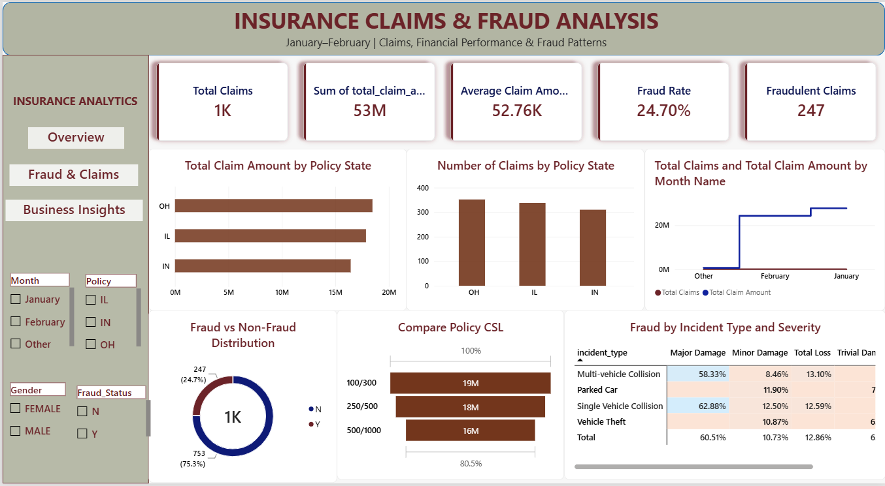
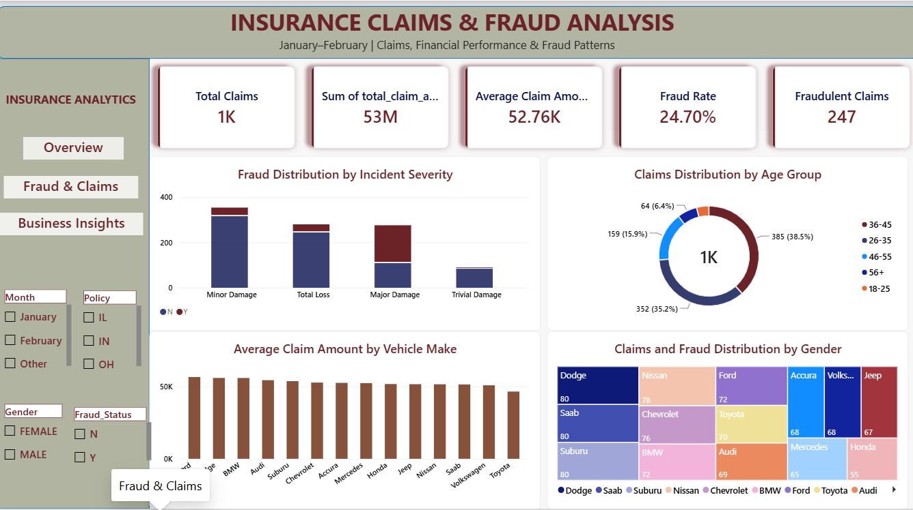
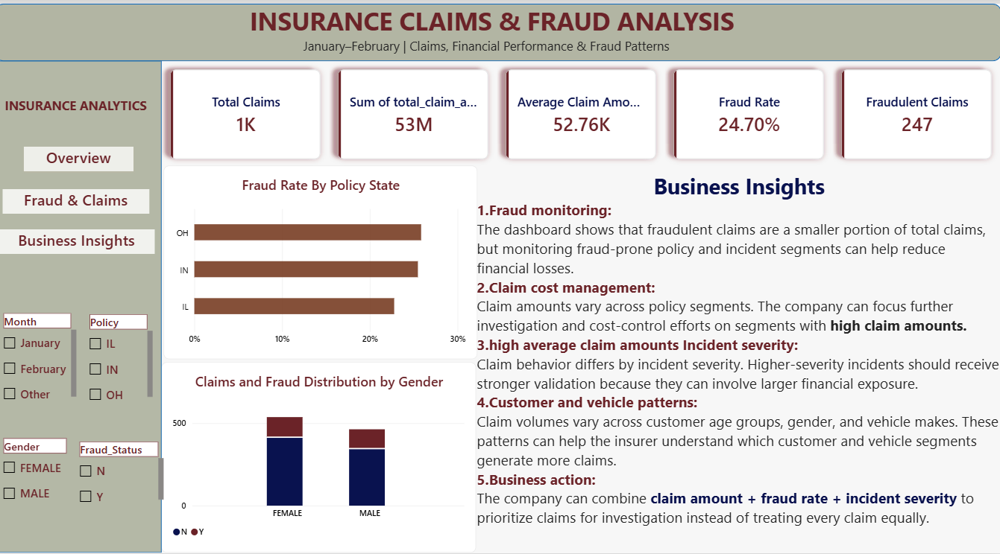

# 🛡️ Insurance Fraud & Claims Analytics — Power BI Dashboard

An interactive Power BI dashboard that analyzes insurance claims data to uncover fraud patterns, understand claim trends, and support better business decisions.


---

## 📌 Business Problem

Insurance companies lose a significant amount of money to fraudulent claims. Management needs a clear view of:

- How many claims are being filed, and for how much?
- What share of claims is reported as fraud?
- Which vehicle makes, states, incident types, and customer groups carry the highest fraud risk?
- How do claims change over time?

This dashboard answers these questions in one place.

---

## 📊 Dashboard Pages

### 1. Overview
High-level KPIs: **Total Claims**, **Total Claim Amount**, **Average Claim Amount**, **Fraud Rate**, and **Fraudulent Claims**, with slicers to filter by policy state, auto make, and more.



### 2. Fraud & Claims
Deep dive into where fraud happens: fraud by **auto make**, **policy state**, **incident type**, and **incident severity**.



### 3. Business Insights
Trends and segments: **monthly claim trends**, **age group** analysis, and customer segments (gender, policy limits).



---

## 🔑 Key Findings

> Replace these with the real numbers from your dashboard before publishing.

- Overall fraud rate: **XX%** across **X,XXX** claims
- Highest fraud rate by auto make: **XXXX (XX%)**
- State with the most claims: **XXXX**
- Incident type with the highest fraud rate: **XXXX**
- Peak claims month: **XXXX**
- Age group with the highest average claim amount: **XXXX**

---

## 🧮 Key DAX Measures

| Measure | Purpose |
|---|---|
| Total Claims | Count of all claims |
| Total Claim Amount | Sum of claim amounts |
| Average Claim Amount | Mean claim value |
| Fraudulent Claims | Count of claims where fraud was reported |
| Fraud Rate | Fraudulent claims ÷ total claims |

Example:

```DAX
Fraud Rate =
DIVIDE ( [Fraudulent Claims], [Total Claims], 0 )
```

> Check the formulas in your file and update this section so it matches your actual measures.

---

## 🛠️ Tools & Skills Used

- **Power BI Desktop**: data modeling, report design, interactive slicers
- **DAX**: calculated measures and columns (Age Group, Incident Month Name)
- **Data cleaning and transformation** in Power Query
- **Visuals**: KPI cards, bar/column charts, donut chart, line chart, funnel, treemap, table, slicers, navigation buttons

---

## 📁 Repository Structure

```
insurance-fraud-claims-analytics/
├── PowerBI/
│   └── Insurance_Fraud_Claims_Dashboard.pbix
├── Data/                # dataset (or sample)
├── screenshots/
│   ├── overview.png
│   ├── fraud_claims.png
│   └── business_insights.png
└── README.md
```

---

## ▶️ How to Open the Dashboard

1. Download the `.pbix` file from the `PowerBI` folder.
2. Open it with **Power BI Desktop** (free from Microsoft).
3. Use the slicers and page buttons to explore.

---

## 🚀 Possible Improvements

- Add a fraud risk score by customer segment
- Add drill-through pages for individual claim details
- Connect to a live database (SQL) instead of a static file
- Publish to Power BI Service for sharing

---

## 👩‍💻 Author

**Payal Patole**
Aspiring Data Analyst | Pune, India
🔗 GitHub: [payalpatole-2004](https://github.com/payalpatole-2004)
